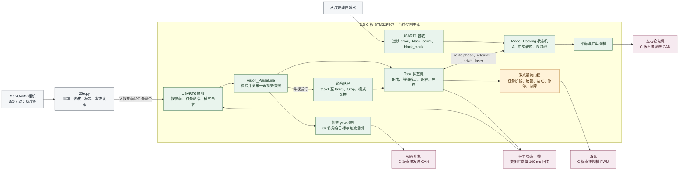
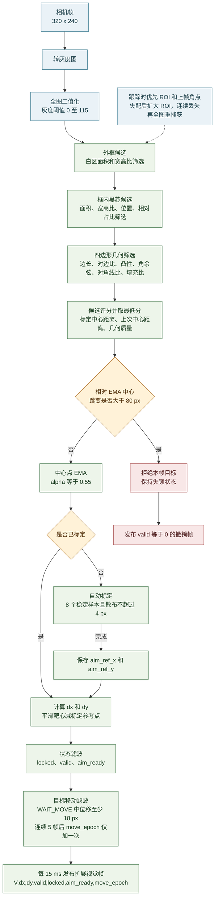
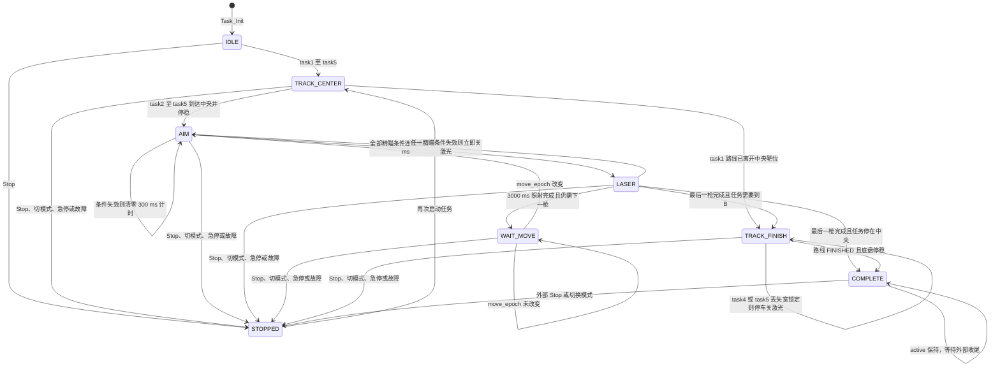
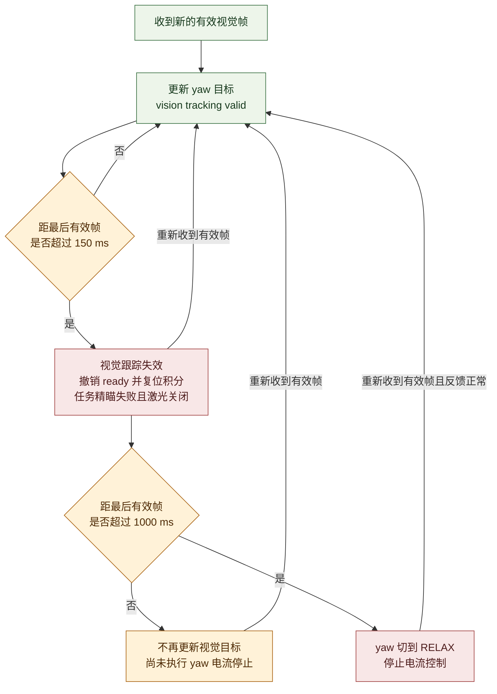
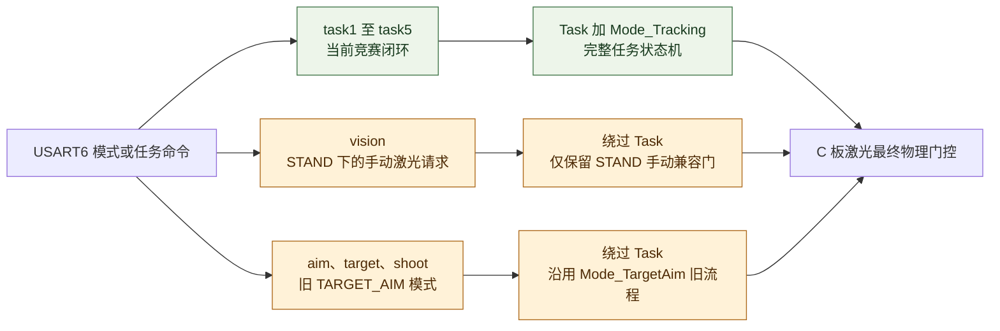

# 当前控制与视觉闭环流程图

本文描述当前工作区实际采用的闭环，不描述旧文档中的 ESP32 未来架构。当前由 **DJI C 型开发板 STM32F407** 直接接收 UART 视觉与命令，运行路线和任务状态机，控制 yaw 电机 CAN，并完成激光 PWM 的最终安全门控。MaixCAM2 上的 `25e.py` 负责图像识别、标定、目标状态滤波和视觉结果发布。

## 1. 当前系统边界



当前链路中没有 ESP32 中间控制层。ESP32 若将来加入，应视为另一版架构，不能用于解释本实现中的 UART、yaw 或激光归属。

## 2. 25e.py 视觉算法链



候选评分是“越低越优”：优先接近标定参考点，并以更高权重保持接近上一帧中心，同时惩罚非直角和对角线比例异常。外框角点用于排除背景矩形，最终 yaw 与标定使用黑芯矩形中心。

视觉输出状态含义：

| 字段 | 当前生成条件 |
|---|---|
| `locked` | 本帧通过外框、黑芯、几何、评分和跳变拒绝后仍存在目标 |
| `valid` | 页面处于运行状态、当前阶段允许输出、已经标定且目标锁定 |
| `aim_ready` | `valid` 成立，且 `abs(dx) <= 2 px`、`abs(dy) <= 2 px` |
| `move_epoch` | 仅在 C 板回报 `WAIT_TARGET_MOVE` 时检测；目标相对锚点移动至少 18 px 并连续确认 5 帧后递增一次 |

## 3. 竞赛任务状态机



中央静止精瞄进入 `LASER_DWELL` 的完整条件为：

```text
motion_settled
&& laser_motion_safe
&& vision_fresh
&& vision_valid
&& target_locked
&& vision.aim_ready
&& abs(dx) <= 2 px
&& gimbal_ready
```

这些条件必须连续保持 300 ms。3000 ms 照射期间任一条件失效，C 板在下一个控制周期关激光并返回 `AIM_ACQUIRE`，稳定计时和照射计时均重新开始。

`AIM_ACQUIRE`、`WAIT_TARGET_MOVE` 以及 task4/task5 的返程等待均为 **fail-closed 且无超时**：条件不满足时保持激光关闭，或同时停止底盘，不会因等待过久自动跳到下一阶段。

### task4/task5 返程区别

返程不是中央靶位的静止精瞄。它使用更宽的锁定条件：

```text
vision_fresh
&& vision_valid
&& target_locked
&& gimbal_ready
```

返程不要求 `aim_ready`、`abs(dx) <= 2 px`、`motion_settled` 或 `laser_motion_safe`。宽锁定成立时允许底盘继续巡线，同时允许激光开启；丢锁则立即停止底盘并关闭激光，重新锁定后继续。刚完成第二枪进入返程的第一个控制周期会抑制一次返程激光，避免阶段切换瞬间误亮。

到达 B 后，路线进入 `FINISHED` 且底盘停稳即可进入 `COMPLETE`；终点视野丢锁不会再阻止 task4/task5 完成。`COMPLETE` 中任务输出仍保持 `active=1`，不会自行退回 `IDLE`，必须由外部 `Stop`、切换模式或启动新任务完成收尾。

## 4. A 到中央再到 B 的路线时序


| 路线门槛 | 当前值 | 判定要点 |
|---|---:|---|
| A 标志确认 | 40 ms | 宽标志且保持前进 |
| 离开 A | 300 ms | 宽标志消失且保持前进 |
| 中央标志确认 | 80 ms | 中央标志且保持前进 |
| 中央 runout | 500 ms | 按实际前进时间累计 |
| 离开中央 | 1200 ms | `target_release` 后按实际前进时间累计 |
| 中央标志退出 | 300 ms | 中央标志消失且保持前进 |
| B 标志确认 | 40 ms | 宽标志且保持前进 |
| B 点 runout | 500 ms | 按实际前进时间累计 |

## 5. 视觉超时与 yaw 电流停止



两个时间门槛含义不同：

| 门槛 | 作用 |
|---:|---|
| 150 ms | 视觉新鲜度或 yaw 跟踪有效性失效，任务瞄准条件立即失败，激光关闭；这不是 yaw 电流停止时刻 |
| 1000 ms | 自最后有效视觉帧起持续超时后，yaw 模式切到 `RELAX`，停止电流控制 |

任务侧的 `vision_fresh` 按“是否收到新视觉帧”计时；新帧即使声明 `valid=0` 也会刷新帧时间，但 `vision_valid` 会独立使瞄准或返程锁定失败。yaw 侧则按“最后一个有效视觉帧”计时。

## 6. 兼容旁路



`vision` 和旧 `TARGET_AIM` 是为调试与旧操作流程保留的旁路，不参与 `task1~task5` 的 `Task` 阶段、射击计数、目标移动确认或任务完成判定，也不能用来说明竞赛闭环的安全时序。

## 7. task1 至 task5 行为

| 命令 | 中央射击 | 目标移动 | 最终位置 | 锁定返程 | 里程碑上报 |
|---|---:|---|---|---|---|
| `task1` | 0 次 | 无 | B | 否 | 否 |
| `task2` | 1 次 | 无 | B | 否 | 否 |
| `task3` | 2 次 | 第一枪后等待 `move_epoch` 改变 | 中央 | 否 | 否 |
| `task4` | 2 次 | 第一枪后等待 `move_epoch` 改变 | B | 是，宽锁定 | 否 |
| `task5` | 2 次 | 第一枪后等待 `move_epoch` 改变 | B | 是，宽锁定 | 是 |

task5 里程碑位：`0x01` 到达中央、`0x02` 第一枪完成、`0x04` 第二枪完成、`0x08` 锁定返程完成。

## 8. 协议与状态编号

视觉扩展帧：

```text
V,dx,dy,valid,locked,aim_ready,move_epoch\n
```

兼容旧视觉帧：

```text
dx,dy,valid\n
```

旧帧只将 `locked` 映射为 `valid`，并令 `aim_ready=0`、`move_epoch=0`，所以可供普通视觉跟踪兼容使用，不能直接通过竞赛任务的自动射击条件。

任务状态帧：

```text
T,task_id,phase,shot_index,aim_ready,laser,milestones,done\n
```

| phase | 状态 |
|---:|---|
| 0 | `IDLE` |
| 1 | `TRACK_TO_CENTER` |
| 2 | `AIM_ACQUIRE` |
| 3 | `LASER_DWELL` |
| 4 | `WAIT_TARGET_MOVE` |
| 5 | `TRACK_TO_FINISH` |
| 6 | `COMPLETE` |
| 7 | `STOPPED` |

## 9. 代码索引

- `25e.py`：灰度识别、外框黑芯几何筛选、评分、EMA、标定、目标状态和扩展视觉帧。
- `Device/vision/vision.c`：新旧视觉协议解析和一致快照发布。
- `Application/ins/ins_task.c`：USART6 分流、命令队列和任务状态回传。
- `Application/gimbal/gimbal_task.c`：任务输入汇总、视觉新鲜度、yaw CAN 控制和激光最终门控。
- `task/task_control.c`：竞赛任务状态机、射击计时、返程和完成判定。
- `task/task1.c` 至 `task/task5.c`：五个任务的行为参数。
- `mode/mode_tracking.c`：A、中央和 B 的巡线路线状态机。
- `mode/mode_control.c`：任务输出与底盘运动命令的汇合点。
- `mode/mode_target_aim.c`：旧 `TARGET_AIM` 兼容旁路。
